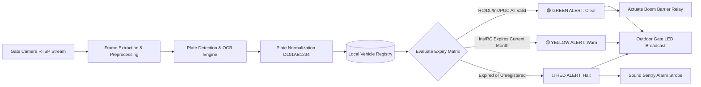
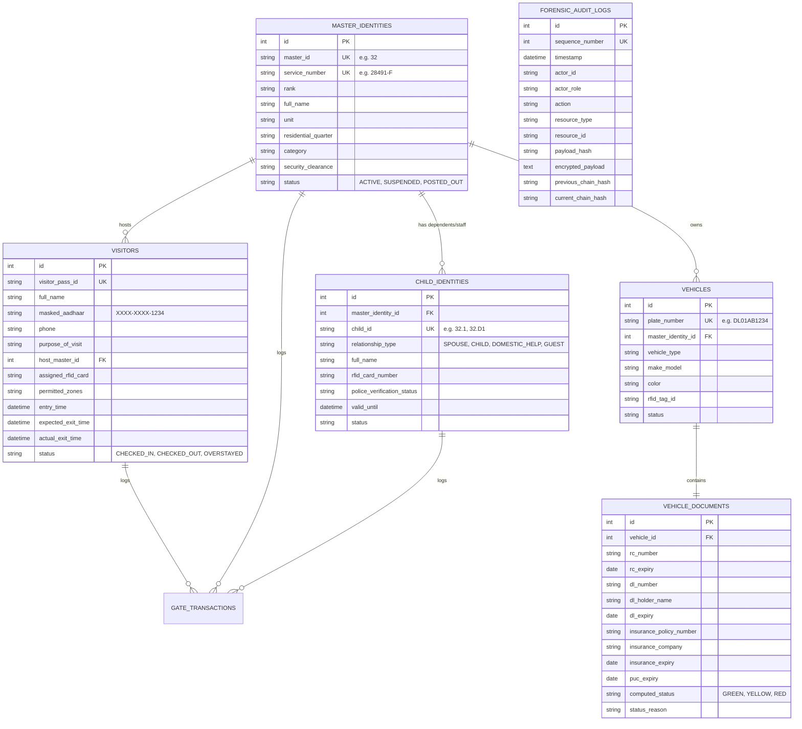

# System Architecture Document
## Centralized eSSL Biometric, ANPR Vehicle Intelligence & Visitor Command Platform

### 1. High-Level System Architecture Topology

```
                                  AIR-GAPPED STATION LAN (100% ON-PREMISES)
 ┌────────────────────────────────────────────────────────────────────────────────────────────────────────┐
 │                                                                                                        │
 │  ┌────────────────────────┐    ┌────────────────────────┐    ┌──────────────────────────────────────┐  │
 │  │ eSSL Multi-Biometric   │    │ Gate ANPR IP Cameras   │    │ Reception / Visitor Workstation      │  │
 │  │ Terminals (All-in-One: │    │ (RTSP Stream @ 25 FPS) │    │ - 2D Aadhaar QR Scanner (USB/HID)    │  │
 │  │ Face + Finger + RFID)  │    │ Entry & Exit Lanes     │    │ - Thermal Badge Printer & RFID Writer│  │
 │  └───────────┬────────────┘    └───────────┬────────────┘    └──────────────────┬───────────────────┘  │
 │              │                             │ RTSP Video Feed                    │ USB / Local API      │
 │              │                             ▼                                    │                      │
 │              │                 ┌────────────────────────┐                       │                      │
 │              │                 │ Edge ANPR Engine       │                       │                      │
 │              │                 │ (YOLOv8 + CRNN OCR)    │                       │                      │
 │              │                 └───────────┬────────────┘                       │                      │
 │              │                             │ Normalized Plate / BBox            │                      │
 │              ▼                             ▼                                    │                      │
 │  ┌──────────────────────────────────────────────────────────────────────────────┴───────────────────┐  │
 │  │                              eSSL Multi-Channel Ingestion Layer                                   │  │
 │  │  ┌─────────────────────────┐  ┌──────────────────────────┐  ┌──────────────────────────────────┐  │  │
 │  │  │ Channel 1: C# Bridge    │  │ Channel 2: HTTP Web API  │  │ Channel 3: Direct SQL Sync       │  │  │
 │  │  │ (eSSL Standalone SDK /  │  │ (eSSL SOAP /asmx &       │  │ (eTimeTrackLite MS SQL /         │  │  │
 │  │  │ zkemkeeper.dll :4370)   │  │ ADMS /iclock/cdata Push) │  │ PostgreSQL Connector)            │  │  │
 │  │  └───────────┬─────────────┘  └────────────┬─────────────┘  └──────────────────┬───────────────┘  │  │
 │  └──────────────┼─────────────────────────────┼───────────────────────────────────┼──────────────────┘  │
 │                 └─────────────────────────────┼───────────────────────────────────┘                     │
 │                                               ▼                                                         │
 │                 ┌──────────────────────────────────────────────────────────────┐                        │
 │                 │            Centralized Server Core (FastAPI / Python)        │                        │
 │                 │  - Employee Master Hierarchy & Dependent Cascading Engine    │                        │
 │                 │  - Vehicle Document Intelligence & Expiry Analytics          │                        │
 │                 │  - Visitor Management & Offline Aadhaar Cryptographic Engine │                        │
 │                 │  - Real-Time Attendance & Presence Tracking Engine           │                        │
 │                 │  - Automated Overstay Watchdog & Alert Dispatcher            │                        │
 │                 │  - DPDP-23 Data Protection & Masking Filters                 │                        │
 │                 │  - SHA-256 Chained Forensic Audit Ledger                     │                        │
 │                 └──────────────┬──────────────────┬────────────┬───────────────┘                        │
 │                                │                  │            │                                        │
 │          ┌─────────────────────┴──────┐     ┌─────┴────────┐   └──────────┐                             │
 │          ▼                            ▼     ▼              ▼              ▼                             │
 │  ┌─────────────────┐       ┌───────────────────────┐  ┌──────────────┐  ┌────────────────────────┐      │
 │  │ PostgreSQL 16   │       │ Redis In-Memory State │  │ Boom Barrier │  │ Outdoor Gate LED Screen│      │
 │  │ / SQLite        │       │ - Live Presence Tally │  │ Relay Module │  │ - Green (All Clear)    │      │
 │  │ - AES-256 At    │       │ - Overstay Queue      │  │ (Open/Halt)  │  │ - Yellow (Expiring)    │      │
 │  │   Rest Encrypted│       │ - WebSocket Broadcast │  └──────────────┘  │ - Red (Halt Alert)     │      │
 │  └─────────────────┘       └───────────────────────┘                    └────────────────────────┘      │
 │                                         │                                                               │
 │                                         ▼                                                               │
 │                     ┌────────────────────────────────────────────────────────┐                          │
 │                     │ Management & Sentry Workstation Web Consoles           │                          │
 │                     │ - Live Gate Lane Monitor & LED Mirror                  │                          │
 │                     │ - Present / Absent Daily Attendance Matrix             │                          │
 │                     │ - Who Entered But Not Exited (Live On-Premise Tracker) │                          │
 │                     │ - Vehicle RC/DL/Insurance/PUC Expiry Analytics         │                          │
 │                     │ - Visitor Pass Designer & Emergency Evacuation Roll    │                          │
 │                     └────────────────────────────────────────────────────────┘                          │
 └─────────────────────────────────────────────────────────────────────────────────────────────────────────┘
```

---

### 2. eSSL Tri-Mode Hardware Ingestion Architecture

eSSL biometric terminals support three distinct integration modes, all supported concurrently:

#### Mode 1: Direct Standalone SDK Bridge (`zkemkeeper.dll`)
- **Protocol**: Direct TCP/IP communication over port `4370`.
- **Driver**: Compiled C# service (`BiomaxBridge.exe` / `eSSLBridge.exe`) linking `Interop.zkemkeeper.dll`.
- **Capabilities**:
  - Millisecond-latency push events (`OnAttTransactionEx`).
  - Face template upload (`SetUserFaceStr`), biometric photo upload (`SendFile`), and fingerprint template sync (`SetUserTmpEx64`).
  - Terminal clock synchronization (NTP) and remote relay door trigger (`ACUnlock`).

#### Mode 2: Web API & ADMS Push Server
- **SOAP 1.1 Web Service**: Exposes `/iclock/WebAPIService.asmx` handling:
  - `AddEmployee`, `BlockUnblockUser`, `DeleteUser`, `GetTransactionsLog`, `GetCommandStatus`.
- **ADMS HTTP Push**: Device automatically posts logs to `/iclock/cdata?SN=...&table=ATTLOG`.

#### Mode 3: Direct SQL Database Synchronization
- **Backend Compatibility**: Connects directly to eSSL's `eTimeTrackLite` MS SQL Server or PostgreSQL database.
- **Tables Synced**:
  - `Employees`: Master data mapping (`EmployeeCode`, `EmployeeName`, `CardNo`, `Department`).
  - `DeviceLogs`: Real-time biometric punch sync (`UserId`, `LogDate`, `Direction`).
  - `Devices`: Status monitoring, IP, and terminal ping health.

---

### 3. ANPR & Vehicle Document Intelligence Pipeline



#### Expiry Calculation Rules:
1. $T_{\text{today}} = \text{Current station date}$, $T_{\text{month\_end}} = \text{Last day of current month}$.
2. **RED**: Any document expiry date $< T_{\text{today}}$ OR Plate is unregistered OR Vehicle is blacklisted.
3. **YELLOW**: $T_{\text{today}} \le \text{Earliest document expiry date} \le T_{\text{month\_end}}$.
4. **GREEN**: All documents valid beyond $T_{\text{month\_end}}$ AND Station Pass is active.

---

### 4. Database Schema (Core Relational Architecture)



---

### 5. Repository File & Directory Structure

```
Biometric-af-software/
├── PRD.md                       # Product Requirements Document
├── Architecture.md              # System Architecture & Flow
├── Rules.md                     # Constraints, Guidelines & Boundary Rules
├── Phases.md                    # Detailed Implementation Phases & Milestones
├── Design.md                    # Visual Theme, Design System & UX Standards
├── run_platform.py              # Main Server Launcher
├── start_station_server.bat     # Windows 1-Click Batch Runner
├── Biometric/                   # Raw Vendor SDKs & Manuals
│   ├── AI -device SDK/          # eSSL Standalone SDK (zkemkeeper.dll)
│   ├── eSSL_web software mannual.pptx
│   └── Web API Service _Sample Data (6).docx
├── server/
│   ├── app/
│   │   ├── core/
│   │   │   ├── config.py        # Centralized settings & air-gapped constants
│   │   │   ├── security.py      # AES-256-GCM, PBKDF2 hashing, RBAC tokens
│   │   │   └── audit.py         # SHA-256 chained forensic audit ledger
│   │   ├── db/
│   │   │   ├── database.py      # Database engine & sessionmaker
│   │   │   └── models.py        # SQLAlchemy relational data models
│   │   ├── modules/
│   │   │   ├── identity/        # Master ID & dependent hierarchy cascading
│   │   │   ├── essl/            # eSSL direct socket driver & SOAP/Push Web API
│   │   │   ├── migration/       # eTimeTrackLite / SQL legacy migration engine
│   │   │   ├── vehicle/         # ANPR detector & RC/DL/Insurance validator
│   │   │   ├── led_display/     # Gate LED display UDP/TCP broadcast driver
│   │   │   ├── visitor/         # Offline Aadhaar QR parser & pass badge generator
│   │   │   ├── command/         # Headcounts, Present/Absent & Overstay engine
│   │   │   └── compliance/      # DPDP-23 retention & CERT-In VAPT hardening
│   │   ├── api/                 # REST API Routers for all modules
│   │   └── main.py              # FastAPI application, static mounting & WebSockets
│   ├── biomax_bridge/           # Standalone C# .NET SDK Bridge Service
│   │   ├── BiomaxBridge.cs      # Native C# event listener
│   │   ├── Interop.zkemkeeper.dll
│   │   └── build_bridge.bat     # Compilation script via Framework csc.exe
│   └── static/
│       └── index.html           # Unified Command & Sentry Workstation Web UI
├── tests/
│   └── test_system.py           # End-to-end automated regression test suite
└── data/                        # Local SQLite DB, encrypted photos & passes
```

---

### 6. Hardware & Deployment Specifications

- **Centralized Server**:
  - Intel Core i7 / Xeon (8 Cores, 16 Threads), 16 GB+ RAM, 512 GB NVMe SSD + 1 TB HDD.
  - OS: Windows 10/11 Pro / Windows Server 2022 or Ubuntu 22.04 LTS.
- **Biometric Terminals**:
  - eSSL Multi-Biometric Terminals (uFace, SilkBio, MB series) connected via dedicated Cat6 LAN on VLAN 10 (Access Control).
- **ANPR Cameras**:
  - 4MP/5MP IP IR Cameras with motorized varifocal lens (5-50mm) streaming RTSP H.264 over VLAN 20 (Surveillance).
- **Gate Barrier & LED Displays**:
  - Outdoor P4/P5/P10 RGB Matrix LED screens connected via TCP/UDP or RS485 converter.
  - Boom barrier dry contact relay triggered via digital I/O controller.
